# EC2 Monitoring and Alerting with Amazon CloudWatch and SNS
## 1. Project Overview

Monitoring is an important part of managing cloud infrastructure. It helps administrators understand how resources are performing, identify unusual behaviour and respond when something requires attention.

In this lab, I worked with Amazon CloudWatch and Amazon Simple Notification Service (SNS) to monitor an Amazon EC2 instance and receive email notifications when its CPU utilization exceeded a configured threshold.

I created an SNS topic, subscribed to it using my email address, configured a CloudWatch alarm and performed a CPU stress test to observe how the monitoring and notification process worked.

I also created a CloudWatch dashboard to visualize the instance's CPU utilization.

One of the interesting aspects of this exercise was understanding how an increase in CPU utilization can serve as an indication that something unusual is happening within an instance. Although high CPU utilization can result from normal workloads, it can also be associated with application problems or potentially malicious activity.

The objective was therefore not just to configure an alarm, but to understand how monitoring can help make unusual resource behaviour visible.

---

## 2. Understanding Logging and Monitoring

Logging and monitoring are related practices, but they serve different purposes.

### What is logging?

Logging involves recording and storing information about events and activities that happen within a system.

Logs provide detailed information that can help administrators understand what happened, when it happened and, depending on the information recorded, what might have caused a problem.

From a security perspective, logs can help identify unusual activities and potential warning signs that might otherwise go unnoticed.

For example, when investigating an application problem, logs may provide information about errors or activities that occurred around the time the problem started.

### What is monitoring?

Monitoring involves collecting and analysing information to understand the performance and behaviour of systems and resources.

It helps administrators determine whether resources are operating as expected and identify changes that might require investigation.

For example, monitoring CPU utilization can help identify when an EC2 instance is experiencing unusually high resource consumption.

### Why are both important?

Consider an EC2 instance that suddenly starts using a large percentage of its available CPU capacity.

Monitoring can help identify the increase and notify an administrator that attention may be required.

Logging can provide additional information that helps investigate what was happening within the system.

Together, logging and monitoring improve visibility into infrastructure performance and security.

---

## 3. AWS Services Used

| AWS Service | Purpose in this Project |
| :--- | :--- |
| **Amazon EC2** | Provided the instance whose CPU utilization was monitored. |
| **Amazon CloudWatch** | Collected CPU utilization metrics and evaluated the configured alarm condition. |
| **Amazon SNS** | Delivered email notifications when the CloudWatch alarm entered the configured state. |
| **AWS Systems Manager** | Provided access to the EC2 instance through Session Manager. |

The lab environment already included a preconfigured EC2 instance named `Stress Test`, with an attached IAM role that allowed access through Systems Manager Session Manager.

---

## 4. Understanding Amazon CloudWatch Metrics and Alarms

Before configuring the alarm, it is important to understand what CloudWatch was monitoring.

### What is a CloudWatch metric?

A metric is a measurement collected about a resource or service.

In this exercise, the metric was `CPUUtilization`, which measures the percentage of allocated EC2 compute capacity being used.

CloudWatch allowed me to view this metric and observe how CPU utilization changed during the exercise.

Initially, the CPU utilization was approximately `0` because no significant workload was running on the instance.

### What is a CloudWatch alarm?

A CloudWatch alarm monitors a metric or mathematical expression and evaluates it against a configured condition.

When the metric meets the specified condition over the configured evaluation period, the alarm can change state and initiate an action.

For this lab, I configured an alarm to monitor the CPU utilization of the `Stress Test` instance.

The alarm was configured as follows:

| Configuration | Selected Value |
| :--- | :--- |
| **Metric** | `CPUUtilization` |
| **Instance** | `Stress Test` |
| **Statistic** | Average |
| **Period** | 1 minute |
| **Threshold Type** | Static |
| **Comparison** | Greater than |
| **Threshold** | 60% |
| **Alarm Name** | `LabCPUUtilizationAlarm` |

### What does the 60% threshold mean?

The 60% threshold represents the CPU utilization level selected for this exercise.

The alarm was configured to evaluate the average CPU utilization over a one-minute period and enter the **In alarm** state when the configured condition was met.

For example, if the average CPU utilization exceeded 60% during the relevant evaluation period, the alarm could be triggered.

It is important to understand that 60% is not a universal definition of unhealthy CPU utilization.

An appropriate threshold depends on the workload, instance capacity, application requirements and expected operating behaviour.

A workload that normally uses 70% CPU might not be unusual, while an unexpected increase from 10% to 90% could deserve investigation.

The threshold should therefore be selected based on the expected behaviour of the environment being monitored.

---

## 5. Understanding the CloudWatch and SNS Notification Workflow

One of the main concepts demonstrated in this lab was how different AWS services work together.

CloudWatch monitors the resource, evaluates the alarm condition and initiates a notification action. SNS handles the delivery of that notification to the subscribed email address.

### Workflow Architecture

```text
[Amazon EC2] ──(Generates Metrics)──> [Amazon CloudWatch] ──(Evaluates 60% Threshold)──> [CloudWatch Alarm]
                                                                                               │
                                                                                        (Triggers Action)
                                                                                               ▼
[User Email] <──(Delivers Notification)── [Amazon SNS Topic] <───────(Sends Alert)─────────────┘
```

#### How the workflow operates:
1. **Amazon EC2 generates metrics:** The EC2 instance produces CPU utilization data that CloudWatch can monitor.
2. **CloudWatch evaluates the metric:** CloudWatch evaluates the CPU utilization metric against the configured 60% threshold and evaluation settings.
3. **The alarm triggers an action:** When the configured condition is met, the alarm enters the **In alarm** state and initiates its configured notification action.
4. **Amazon SNS handles notification delivery:** The alarm sends a notification to the configured SNS topic.
5. **SNS delivers the email:** SNS forwards the notification to the subscribed email endpoint.

### Why did the SNS subscription need confirmation?

When I created the email subscription, its initial status was **Pending confirmation**.

SNS sent a confirmation email to the address I provided. I had to open that email and confirm the subscription.

After confirmation, the subscription status changed to **Confirmed**.

This step is important because the email endpoint must confirm that it wants to receive notifications from the topic.

Without a confirmed email subscription, the intended email notification workflow would not be fully established.

---

## 6. Implementation

### Step 1: Configure Amazon SNS

I started by creating an SNS topic named: `MyCwAlarm`

I selected the **Standard** topic type and created an email subscription using an email address I could access.

After receiving the confirmation email, I confirmed the subscription.

I returned to the AWS console and verified that its status had changed from **Pending confirmation** to **Confirmed**.

At this point, the SNS topic was ready to receive notifications from the CloudWatch alarm and deliver them to my email address.

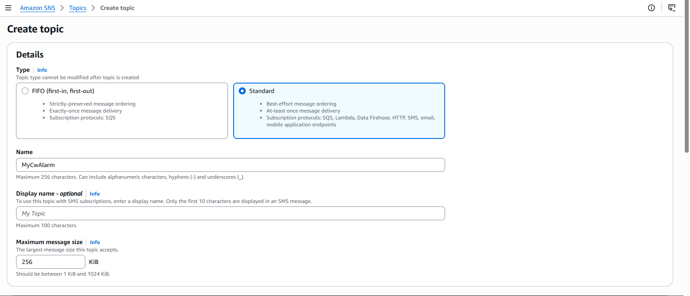  

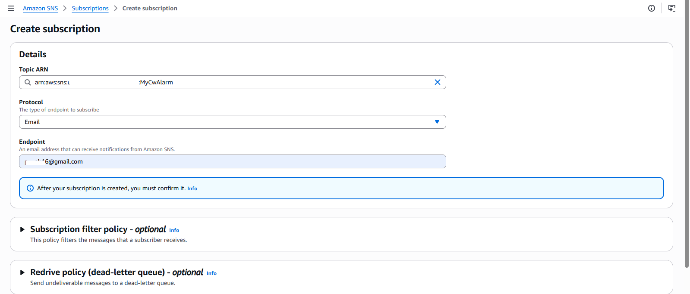  

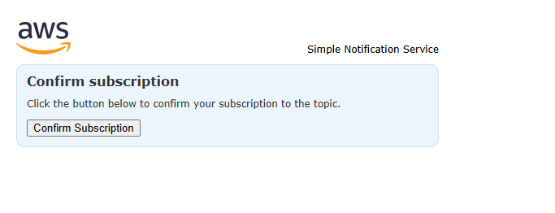
---

### Step 2: Configure the CloudWatch Alarm

Next, I opened Amazon CloudWatch and navigated to **Metrics**.

Under **EC2 Per-Instance Metrics**, I selected the `CPUUtilization` metric associated with the `Stress Test` instance.

I then created a metric alarm using the configuration described in Section 4.

Under **Configure actions**, I selected the **In alarm** state trigger and associated the alarm with the existing SNS topic, `MyCwAlarm`.
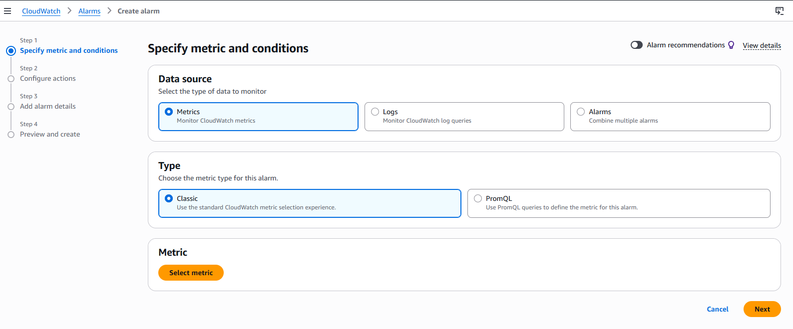 

Finally, I named the alarm: `LabCPUUtilizationAlarm`

This established the relationship between the EC2 CPU metric, the CloudWatch alarm and the SNS notification topic.


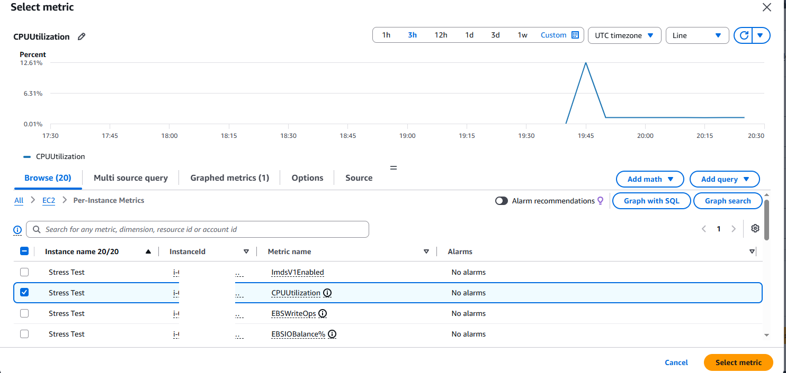  
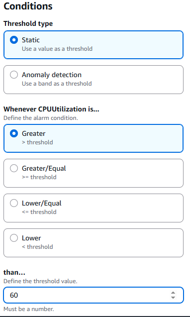 
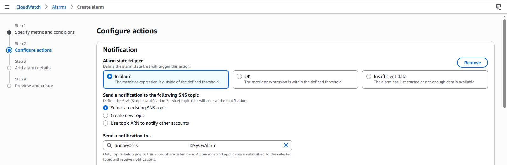

---

### Step 3: Generate CPU Utilization Using a Stress Test

After configuring the alarm, I accessed the `Stress Test` EC2 instance using the connection provided through the lab environment.

I ran the following command:

```bash
sudo stress --cpu 10 -v --timeout 400s
```

The command used the `stress` utility to generate CPU load for 400 seconds.

The `--cpu 10` option specified ten CPU stress workers, while `--timeout 400s` specified how long the test should run.

The purpose was to deliberately increase CPU utilization and observe how CloudWatch responded.

To observe the CPU usage from another terminal session, I executed:

```bash
top
```

The `top` command displayed live system resource usage, allowing me to observe the CPU activity while the stress test was running.

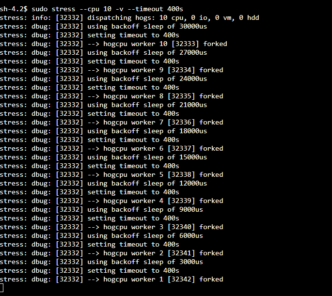  

---

### Step 4: Verify the CloudWatch Alarm and SNS Notification

After starting the stress test, I returned to the CloudWatch Alarms page and monitored `LabCPUUtilizationAlarm`.

As CPU utilization increased above the configured threshold, the alarm changed to the **In alarm** state.

I then checked my email inbox and confirmed that I had received the notification from **AWS Notifications**.

This verified that the monitoring and notification workflow was functioning as expected.

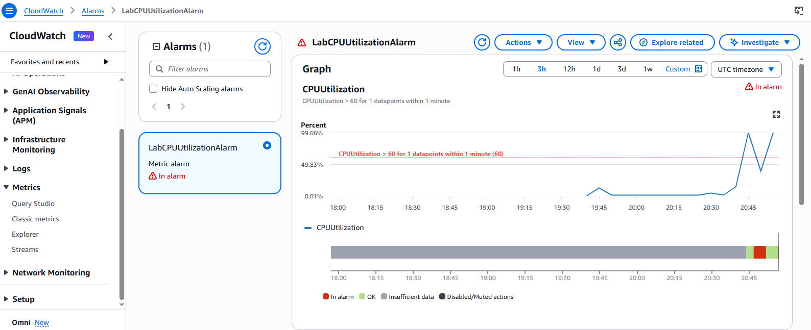  

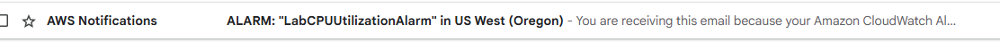  

---

### Step 5: Create a CloudWatch Dashboard

Finally, I created a CloudWatch dashboard named: `LabEC2Dashboard`

I added a line graph using the `CPUUtilization` metric associated with the `Stress Test` instance.

After saving the dashboard, I could access the CPU utilization graph from a single monitoring view.

A dashboard is useful because it brings selected metrics and alarms together, making it easier to observe resource behaviour without navigating through multiple metric pages.


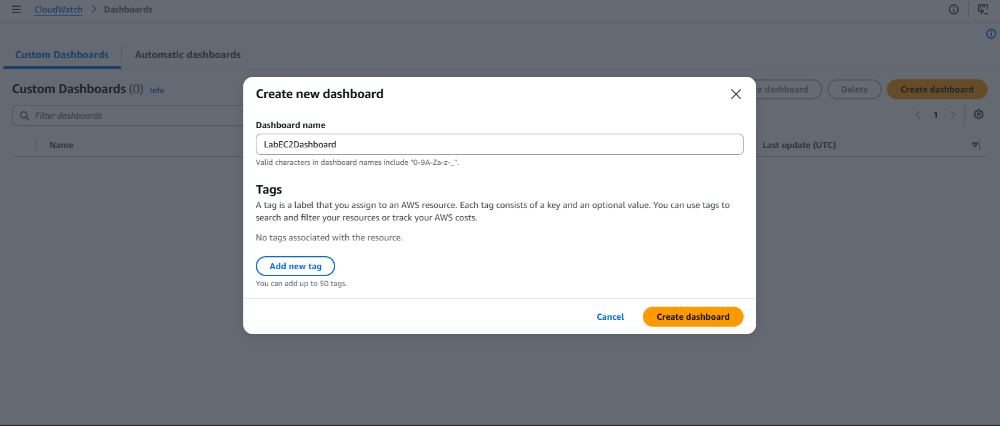  
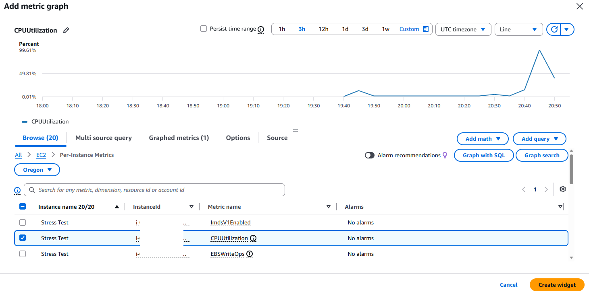

---

## 7. Testing and Verification

The following table summarizes the tests performed and their expected results.

| Test | Expected Result | Verification |
| :--- | :--- | :--- |
| **Create SNS subscription** | Subscription becomes Confirmed | Checked subscription status. |
| **Configure CloudWatch alarm** | Alarm monitors CPU utilization | Reviewed alarm configuration. |
| **Run CPU stress test** | CPU utilization increases | Used `top` and CloudWatch metrics graph. |
| **Trigger alarm** | Alarm enters **In alarm** state | Observed alarm status. |
| **Send SNS notification** | Email notification is received | Checked email inbox. |
| **Create dashboard** | CPU utilization graph is displayed | Opened saved dashboard. |

> **Result:** All four lab tasks were completed successfully. The CloudWatch alarm was triggered, the SNS email notification was received and the dashboard was created.

---

## 8. Troubleshooting and Investigation

Even when a monitoring setup works as expected, it is important to understand what to investigate when something goes wrong.

The following are potential troubleshooting scenarios based on the configuration used in this lab. They are additional investigation exercises, not errors I encountered during the practical session.

### Scenario 1: CloudWatch alarm does not trigger

Suppose the stress test is running, but the alarm remains in the **OK** state. Rather than immediately changing the threshold, I would investigate the following:

- **Check 1: Confirm the selected EC2 instance**  
  Make sure the alarm is monitoring the intended `Stress Test` instance. Selecting the wrong instance means CloudWatch could be evaluating a different resource's CPU utilization.
- **Check 2: Check whether CPUUtilization is reporting data**  
  Navigate to CloudWatch Metrics and inspect the CPU utilization graph. Confirm that the metric is available and that its values are changing.
- **Check 3: Confirm that the stress test is running**  
  Use the terminal to inspect the running processes and CPU activity. The `top` command can help determine whether the stress process is consuming CPU resources.
- **Check 4: Review the alarm condition**  
  Confirm that the metric, statistic, period and threshold match the intended configuration. In this lab, the alarm used Average CPU utilization over a one-minute period with a greater-than-60% condition.
- **Check 5: Review the alarm state and history**  
  Inspect the alarm's current state and available history to understand how it has been evaluated.

The aim is to establish whether the issue is with metric collection, the test workload or the alarm configuration.

---

### Scenario 2: The alarm triggers but no email arrives

If the CloudWatch alarm enters the **In alarm** state but no email is received, I would investigate the notification path. Things to check include:

1. Whether the SNS subscription status is **Confirmed**.
2. Whether the correct SNS topic is associated with the alarm.
3. Whether the alarm has an action configured for the **In alarm** state.
4. Whether the email was delivered to another folder, such as spam.

I would also review the alarm and SNS configuration to establish whether the notification action was associated with the intended topic.

---

### Scenario 3: CPU utilization does not increase

If the CPU utilization remains low after starting the stress test, I would investigate:

- Whether the command executed successfully.
- Whether the `stress` utility is available.
- Whether the process is still running.
- Whether I am connected to the correct EC2 instance.
- Whether the CPU utilization metric belongs to that same instance.

The `top` command is useful here because it provides another way to observe activity inside the instance.

---

### Scenario 4: CloudWatch dashboard does not display the expected data

If the dashboard does not show the expected CPU utilization graph, I would check:

- Whether the correct EC2 instance was selected.
- Whether the correct metric was added.
- Whether the dashboard was saved.
- Whether the selected time range includes the period when the stress test ran.

These checks help distinguish between a problem with the underlying metric and a problem with how the dashboard displays it.

---

## 9. Security and Operational Considerations

One of the most important lessons from this lab is that unusual resource utilization deserves attention, particularly when it happens unexpectedly.

An increase in CPU utilization can have several possible causes.

### What could cause a CPU spike?

* **Legitimate workload:** An application may experience increased demand, causing it to use more CPU resources.
* **Application or process issues:** An application may have inefficient operations, excessive processing or a process that consumes more resources than expected.
* **Resource exhaustion:** A system may experience resource pressure when the workload exceeds what the available infrastructure can comfortably handle.
* **Potential malicious activity:** Malware or unauthorized processes may consume system resources. An attacker who gains control of an instance could potentially use its computing resources for unintended activities.

### How would I investigate a suspicious CPU spike?

If I encountered an unexpected increase in a real environment, I would not immediately conclude that the instance had been compromised. I would begin by establishing what changed and when it happened.

My investigation would include:
1. **Examine CloudWatch metrics:** Determine when CPU utilization increased and whether the increase was temporary or sustained.
2. **Inspect running processes:** Use commands such as `top` to identify processes consuming significant CPU resources.
3. **Review system logs:** Look for relevant errors, unusual activities or other events around the time of the spike.
4. **Review available security evidence:** Examine relevant activity records and other security monitoring information.
5. **Establish the likely cause:** Compare the findings with expected application workloads and normal resource behaviour.

A CPU spike alone does not prove malware or unauthorized access. It is an indicator that may justify further investigation.

### Why is alerting important?

Without monitoring and alerting, an administrator might not immediately know that an instance is experiencing unusual resource consumption.

A CloudWatch alarm connected to SNS provides a notification mechanism that can bring changes in resource behaviour to someone's attention.

However, an alert is only the beginning of an investigation. Someone still needs to interpret the information, determine the cause and decide what action is appropriate.

---

## 10. Key Takeaways

This lab helped me understand how Amazon CloudWatch, EC2 and SNS can work together to provide basic infrastructure monitoring and alerting.

I learned how to configure a metric alarm, define a CPU utilization threshold, generate a test workload and verify that an email notification was received.

I also gained a better understanding of why monitoring should be part of everyday infrastructure management rather than something considered only after a problem occurs.

One lesson that stood out to me was the importance of distinguishing between an alert and its underlying cause.

A high CPU utilization alert tells us that a defined condition has been met. It does not explain why the increase happened.

That is where investigation becomes important: examining the available metrics, processes and logs to understand what is happening before deciding how to respond.

---

## 11. Cleanup and Cost Considerations

After completing the exercise, review the resources created specifically for the lab.

Depending on the lab environment, these may include:
* CloudWatch alarm: `LabCPUUtilizationAlarm`
* CloudWatch dashboard: `LabEC2Dashboard`
* SNS topic: `MyCwAlarm`
* SNS email subscription
* EC2 instance (if no longer required)

The EC2 instance was preconfigured as part of the lab environment, so its cleanup should follow the lab provider's instructions.

Always check which resources are still required before deleting them, and avoid leaving unnecessary billable resources running.
